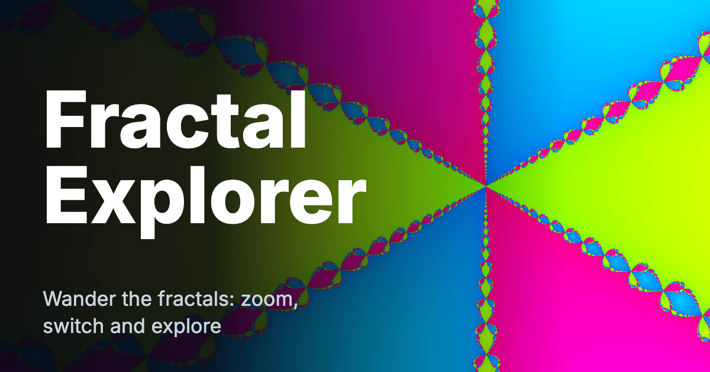

# Next Fractals - Interactive Fractal Explorer

A modern, interactive web application for exploring the infinite beauty of the Mandelbrot set, Julia sets, the Burning Ship, the Perpendicular Ship, the Tricorn, the Multibrot sets, the Newton fractal and the Celtic Mandelbrot set, built with Next.js 16, React 19 and TypeScript.



**Deployment:** A landing on `main` redeploys the staging service by itself.
Production changes only when the human tags a release, through the devops
system. The workflows under `.forgejo/workflows/` are described under
[Deployment](#deployment).

## Live app

- **Production** — https://fractals-nextjs-prod-robymk5mfq-uc.a.run.app — updated when the human tags a release (`v*`).
- **Staging** — https://fractals-nextjs-staging-robymk5mfq-uc.a.run.app — redeployed from `main` after every landing.

## Overview

Next Fractals is a real-time fractal generator that allows users to explore the Mandelbrot set, Julia sets, the Burning Ship, the Perpendicular Ship, the Tricorn, the Multibrot sets, the Newton fractal and the Celtic Mandelbrot set with smooth zoom controls, customizable parameters, and preset configurations. The application uses optimized Canvas API rendering with progressive calculation techniques for smooth performance and provides an intuitive interface for mathematical visualization.

## Features

### 🎨 Interactive Visualization

- **Fractal Types**: Draw the Mandelbrot set, the Burning Ship, the Perpendicular Ship (the ship's cousin, which folds only one half of the step: `x' = x^2 - y^2 + cx`, `y' = -2|x|y + cy`; it takes no setting), the Tricorn, a Multibrot set (the Mandelbrot loop with a higher power, `z^3`, `z^4` or `z^5`, picked from the Power select; a view link carries it as `k=3`, `k=4` or `k=5`), the Newton fractal of `z^3 - 1` (three basins, one colour family per root, shaded by how fast Newton's method gets there; it takes no setting), the Celtic Mandelbrot set (the Mandelbrot loop with the real part of the square folded positive; it takes no setting) or a Julia set, and pick the Julia constant from four named ones or choose Custom and type your own Real and Imaginary parts (each from -2 to 2, written as plain decimals like `-0.8` and `0.156`); an entry that is empty, not a number or out of range shows a message under the boxes and leaves the picture as it was, and a view link carries the point as `k=custom:<re>,<im>`
- **Julia Map**: In Settings, under the Julia constant, the Mandelbrot set drawn small (160 x 120, about 60 iterations, drawn once per colour scheme) as the map of Julia constants. Point at it or drag along it and the constant becomes the point under your pointer — the Julia set on the canvas changes as you move — and one Back returns to the constant you started from; focus it and the arrow keys move the constant by a fiftieth of the width a press, so it is usable without a pointer. The frame is the app's base view centred on the origin (x -2 to 2, y -1.5 to 1.5), which is exactly the box a custom constant may name, so every point of the map is a constant you can pick
- **Fractal Switcher**: Eight buttons over the top left of the picture — Mandelbrot, Julia, Burning Ship, Perp. Ship (the picker's one shortened label, so the row stays readable on a phone; the Math card, a shared link's line and the Help overlay call it Perpendicular Ship), Tricorn, Multibrot, Newton and Celtic, the current one lit — change fractal in one click and fly to that fractal's showpiece place (Seahorse Valley, the Classic set's spirals, the Burning Ship's armada, the whole Perpendicular Ship, the whole three-armed Tricorn, a small copy of the z^3 set, the junction where Newton's three basins meet, the whole Celtic set); Back returns to where you were. While Julia is current a row of chips offers its four named constants and Custom; while Multibrot is current a row captioned "Power" offers z^3, z^4 and z^5
- **Real-time Rendering**: Smooth fractal generation with optimized performance
- **Zoom Controls**: Zoom with the mouse wheel, a two-finger pinch on a touch screen, the Zoom In/Out buttons and the Zoom Level slider, which is logarithmic — equal slider steps are equal zoom ratios from 1x to 10000x
- **Pan Navigation**: Click and drag to explore different regions, or drag with one finger on a touch screen
- **Keyboard Navigation**: Pan with the arrow keys and zoom with `+` and `-` from anywhere on the page — focus does not have to be on the image first — and press R to put the view back on the fractal's default frame as Reset View does. A field, a slider, a button or an open drawer, help or Math card keeps its own keys, and so does any combination with Control, Meta or Alt
- **Help Overlay**: A Help button in the top bar, or the `?` key from anywhere on the page, opens a dialog listing every way to drive the explorer — mouse and touch, keyboard, nearby places and Surprise me, the tour, Auto-wander, and the views and links
- **Center Controls**: Precise positioning with coordinate input under a line that reads the zoom and centre of the view on screen ("Zoom 400x at -0.7453, 0.1127"), and four boxes under Manual Coordinates that apply a view you type in: Apply says so when a box cannot be read or runs the wrong way, and notes when a box of another shape is fitted around its centre to the view's 4:3
- **Math card**: A card over the left of the picture, under the fractal buttons, shows the mathematics of what you are looking at, typeset as native MathML (no library, no font to load) with a plain-text reading for screen readers. It is there from the first visit; the Math button in the top bar hides and shows it, and the browser remembers whether you left it shown and whether you expanded it. Collapsed it is one line, the rule and the fractal's setting with its real value (`z → z² + c, c = −0.8 + 0.156i`); More adds where each point starts, what the setting means, the view's centre as a + bi, width, zoom, iteration cap (the Auto result when Auto is on) and colour scheme, how a point is judged and coloured, a few plain sentences, and the name of the place when the view is on one. Expanded, it also follows your pointer: the number under it, whether that point escaped and at which step (or which root Newton's method settles on), a swatch of the colour the picture paints it, and a small plot of the path that point's orbit took — dots joined by a line, coloured through the picture's own palette, with the axes, the radius of 2 that "escaped" means, the start ringed and the escaping point marked. A point inside the set can be watched spiralling in and a point outside it flying off, which is how the picture is made; a Play button walks it a step at a time, and it is off under reduced motion. The reading holds while your pointer is over the card rather than the picture, so moving onto it to reach that Play button does not take the plot away on the way. The numbers follow the view as you zoom and pan
- **Surprise me**: A button in the middle of the top bar flies to one of the nearby places at random, the way a Nearby tile does — the same crossfade and a single history entry — and never to the place you are already looking at. Press it again for another; it is disabled when no place is near enough to offer
- **Auto-wander**: Press the Auto-wander pill at the bottom right of the picture, or tick Auto-wander in the Auto-wander card of the Settings drawer, and the view moves every few seconds: three small steps to a nearby interesting view, then a hop to a place from the catalogue (about one hop in six changes fractal; the steps in between stay on the fractal on screen)
- **Tour**: A screensaver. Leave the page alone for about 20 seconds (15 once a tour has played and been stopped), press Tour in the top bar, or open it with `#tour` on the address, and every control hides while the picture hops from place to place, about 8 seconds at each, crossfading between them. Any key, touch, click or mouse movement stops it and brings everything back on the place it was showing
- **Nearby Strip**: A strip along the bottom of the picture, headed "Nearby, worth a look", shows small pictures of up to six named places near the view — click one, or Tab to it and press Enter, and the picture flies there with a short crossfade. A More tile rotates in the next suggestions
- **Back and Forward**: Buttons in the top bar retrace the places you jumped to, and are disabled at the ends of the trail
- **Download PNG**: In the Settings drawer, save the canvas at its full resolution, named from the fractal and the view it shows — or pick a Shape and an Export size: a larger whole multiple of the canvas (2x, 4x, or the largest that fits 12 megapixels) draws the same view again off-screen at that size, and a wallpaper shape (Desktop 16:9, Phone 9:19.5, Square 1:1) draws the view framed for that shape at one of its own pixel sizes, each with the shape and size in the filename
- **Shareable Links**: The address bar follows the view once a render settles, and the Copy link button in the Navigation card of the Settings drawer puts that URL — fractal, Julia constant or Multibrot power, centre, zoom, colour scheme with its reverse and shift, iterations and canvas size — on the clipboard. Copy tour link, beside it, shares the journey instead of the view: the places you have just visited, up to the last eight of them, as a walk somebody else can play (see Tour)

### ⚙️ Customizable Parameters

- **Iteration Control**: Adjust detail level with iteration sliders
- **Auto Iterations**: Iterations follow the zoom level; unticking the checkbox takes manual control, and loading a preset turns it off because that preset was framed at its own count
- **Color Mapping**: Dynamic color schemes for enhanced visualization, each with two settings of its own — a Reverse checkbox and a Shift slider (0 to 100 percent) in the Rendering Parameters card, right under the scheme they belong to, with a Reset colours button — that travel with the view in a link, a saved view and a shared preview; changing the scheme or either setting repaints the picture from iteration counts already computed, so it is instant however deep the view. Switching the scheme keeps both, a nearby tile keeps both, and a tour hop or a Surprise me press puts both back so neither is tinted by an old choice
- **Cycle Colours**: The palette can be left to flow: a checkbox and a speed (Slow, Medium, Fast) under the Shift slider walk the shift slowly round a turn and repaint the picture from the counts already computed, so a deep view animates for the price of a colour change and no orbit is ever counted twice. It is a mode and not part of the view — not in the link, not in a saved view, no history entry per frame — so it pauses while a render is in flight, while you drag the picture or the slider, while the Help is up, while a tour plays and while the tab is hidden, and is not offered at all if your system asks for reduced motion. Switching it off leaves the Shift where it stopped, as one history entry
- **Parameter Presets**: Quick access to interesting fractal configurations from the Presets dropdown in the Settings drawer, listing the built-in and saved views for the fractal selected now
- **Custom Presets**: Save and manage your own configurations; a saved view remembers its fractal, for a Julia set its constant, and the palette it was saved in — a view saved before those settings existed opens on the scheme's own colours

### 🚀 Technical Features

- **Canvas API Rendering**: Direct pixel manipulation for optimal performance
- **Progressive Rendering**: Rows are computed in chunks with a yield to the event loop between them, so the UI stays responsive
- **Responsive Design**: Works seamlessly across desktop and mobile devices
- **TypeScript**: Full type safety and enhanced developer experience
- **Controls Stay Usable**: Every control but a screen-size Download PNG works while a render is running, and using one cancels the render in flight and starts the new one; a larger export or a wallpaper draws on a canvas of its own and is not held back by the render on screen

### 🔧 Build, Test and Deploy

- **Containerized Deployment**: Docker-based deployment with multi-stage builds
- **Deploy Contract**: Root `Dockerfile`, server on `$PORT` (8080), `/api/health` route for probes
- **Image Route**: `GET /api/og?<view link>` no longer draws anything. It answers `308` to the pre-built picture the view previews as (`/og/<place-id>.jpg`), or to the static card for a query that is not a view, so a preview URL a crawler cached before the pre-built previews still shows a picture without the server spending CPU on a render
- **Quality Gate**: `make gate` runs install, lint, typecheck, build and the test suite
- **Integration Tier**: `make integration STAGING_URL=<url>` checks a deployment that is already up (see [Integration Tests](#integration-tests))
- **ESLint + TypeScript**: `make check` runs ESLint and `tsc --noEmit`

## Technology Stack

- **Framework**: [Next.js 16](https://nextjs.org/) with App Router
- **UI**: [React 19](https://react.dev/)
- **Language**: [TypeScript](https://www.typescriptlang.org/)
- **Styling**: [Tailwind CSS](https://tailwindcss.com/)
- **Tests**: [Vitest](https://vitest.dev/) (`make test`), plus an integration tier against a deployed app (`make integration STAGING_URL=<url>`)
- **Performance**: Optimized Canvas API rendering

## Getting Started

### Prerequisites

- Node.js 20 or later — the `Dockerfile` and the landing gate image both build on Node 20
- npm (the repo commits a `package-lock.json`)

### Installation

1. Clone the repository:

```bash
git clone <repository-url>
cd fractals-nextjs
```

2. Install dependencies:

```bash
npm install
```

3. Run the development server:

```bash
npm run dev
```

4. Open [http://localhost:3000](http://localhost:3000) in your browser to start exploring!

## Docker Commands

For testing and deployment, you can use these Docker commands:

```bash
# Run the gate's checks in a container, the way the landing gate does
# (`make test-docker` runs this same command)
docker run --rm -v $(pwd):/app -w /app node:20-alpine sh -c "npm ci && npm run build && npm run lint && npx tsc --noEmit"

# Build production Docker image (`make docker-build`)
docker build --platform linux/amd64 -t fractals-nextjs:latest -f Dockerfile .

# Run production container locally (`make docker-run`)
docker run --rm -p 8080:8080 fractals-nextjs:latest
```

The production container will be available at [http://localhost:8080](http://localhost:8080).

## Integration Tests

`make test` is the unit suite: it covers the pure logic in `src/lib` and the
routes, and it never leaves this machine. The integration tier is the other
half. It calls a deployment that is already up — staging, or a container on
`localhost` — over the network, so it is deliberately not part of `make gate` or
`npm test`, which have to keep passing with no network at all.

`make integration` installs the dependencies it needs (`ci-install`) before it
runs them. The staging workflow checks the repository out fresh and runs this
one command, and a fresh checkout has no `node_modules` for `vitest` to be found
in. It checks `STAGING_URL` before that install rather than after, so a run that
forgot it says so in a second, not at the end of an `npm ci`.

```bash
# By hand, against staging:
make integration STAGING_URL=https://fractals-nextjs-staging-robymk5mfq-uc.a.run.app

# Or with npm, which is the command the `make` target ends with:
STAGING_URL=https://... npm run test:integration

# Against a container of your own, or a check of a specific commit:
docker run --rm -p 8080:8080 fractals-nextjs:latest
make integration STAGING_URL=http://localhost:8080 EXPECT_SHA=abc1234
```

Two environment variables, and no others:

- **`STAGING_URL`** (required) — the deployment to test. There is no default:
  the tier has nothing to call without it, and a run without it fails with the
  command to type. A trailing slash is fine.
- **`EXPECT_SHA`** (optional) — the commit the deployment should be serving.
  When it is set, `/api/version` must report exactly it, which is what makes the
  tier evidence that the commit just built is the commit live. Without it, the
  check only asks that the endpoint answers with a `commit` field at all.

Eleven checks, a `GET` or two each, read-only, 15 s per request and one retry:

- `GET /api/health` is 200 and `{"status":"healthy"}`.
- `GET /` is 200 and carries the `<h1>Fractal Explorer</h1>` and the document
  title `Next Fractals - Interactive Fractal Explorer`.
- `GET /api/version` is 200 JSON with a `commit` field, equal to `EXPECT_SHA`
  when that is set.
- `GET /`'s `og:image` and `twitter:image` are `<origin>/og-card-2.png` and its
  `og:url` is `<origin>/` — the origin with its own slash, which is the address
  the page is on, where `<origin>` is the origin of `STAGING_URL`: the page
  names its own host, not another.
- `GET /og-card-2.png` is 200, `image/png`, 1200x630 by its IHDR chunk and
  under 300 KB. It is the social card `src/app/layout.tsx` points its metadata
  at, and it is served out of `public/` by the `Dockerfile`.
- `GET /api/og?<view link>` is 308, `Cache-Control: public, max-age=86400`,
  `Location` the pre-built picture the view previews as (`/og/<place-id>.jpg`);
  a request that is not a view (no query, `v=1&x=banana`, `v=2&f=julia`) is 308
  to `/og-card-2.png`. Both follow on to a picture the server does not draw.
- `GET /?<view link>` — the query form Copy link writes — previews as that
  view: `og:image` and `twitter:image` are the nearest place's pre-built
  picture (`/og/julia-dendrite-whole.jpg` for a deep view of the Dendrite),
  declared `image/jpeg`, `og:url` is `<origin>/?<fragment>`, the title carries
  the view's own line ("Julia set, Dendrite, 400x") and the alt names the place
  the picture is of; the head names no `/api/og`, and the picture itself then
  answers 200 `image/jpeg` with `max-age=86400`.
- `GET /` with no query, or with one that is not a view (`?utm_source=mail`,
  `?v=1`, another version, a field that cannot be read, a 600-character value,
  script-looking text), is the static card: `og:image` and `twitter:image` are
  `<origin>/og-card-2.png`, and none of the request's text reaches the head.
- The link Copy link writes round-trips: the preview of
  `copyLinkUrl(origin, "/", encodeView(view))` decodes back to the same view,
  and its picture is the pre-built file that view names
  (`/og/multibrot-4-whole.jpg` for a power-4 Multibrot view).
- `GET /og/<place-id>.jpg` — the pre-built preview a shared view link names —
  is 200, `image/jpeg`, a JPEG by its own marker, over 1 KB, and
  `Cache-Control: public, max-age=86400, ...`.
- The favicon and the Apple touch icon the page's head links (`/icon.png`,
  `/apple-icon.png`) answer 200 with `image/png`.

What no check here asserts is anything that changes between deployments: not
what the canvas draws, not the fractal list, not the version footer's wording.
The tier answers "is the commit we just built the app that is answering, and are
its endpoints up and its link preview pointing at itself", and a browser smoke test is a later tier of its own.

The staging workflow runs `make integration STAGING_URL=<url> EXPECT_SHA=<commit>`
after it rolls staging onto a landing's commit. Its runner checks the repository
out fresh and holds no cloud credential, so the target installs its own
dependencies and needs nothing else.

## Usage

### Basic Navigation

- **The Page**: The picture fills the window, with a slim bar over it holding the title, Surprise me, Tour, Back, Forward, Math, Help and Settings. The bar fades after two seconds without a pointer move, key press or touch and comes back on any of them, and it stays up while Settings is open or one of its buttons has keyboard focus. Settings opens a drawer down the right-hand side — a bottom sheet on a narrow screen — holding every control the page has: Presets, Navigation, Auto-wander, Coordinates, Rendering Parameters, Canvas Resolution, Manual Coordinates, saved views and Download PNG. Escape, its Close button and a click outside it close it, and opening it does not interrupt a render
- **Fractal switcher**: Over the top left of the picture, under the top bar, are eight buttons — Mandelbrot, Julia, Burning Ship, Perp. Ship, Tricorn, Multibrot, Newton and Celtic — with the fractal on screen lit (`aria-pressed`). One click goes to another fractal and lands on its featured place: Seahorse Valley for the Mandelbrot set, the spirals of the Classic Julia set, the armada of the Burning Ship, the whole Perpendicular Ship (a bowed black hull with rows of masts along its edge on a spike out to -2) the whole three-armed Tricorn (zoomed out far enough that it is not the Mandelbrot set, which is what its real axis is), a small copy of the z^3 set riding on the Multibrot's top lobe, the pinwheel at the origin where Newton's three basins meet and the whole Celtic set (flat-edged body, spike and lace; its real axis is the Mandelbrot set's, so a view zoomed in on the axis is not used), each in its own colour scheme and at the iteration count Auto picks. It is a jump like a Nearby tile, with the same crossfade, and adds one history entry, so Back returns to the previous fractal and view. Pressing the fractal already shown does nothing. While Julia is current a second row of chips, captioned "Julia constant" — Classic, Dendrite, Douady rabbit, Siegel disk and Custom — picks the constant: a named chip goes to the whole of that constant's set, and Custom opens Settings with the cursor in the Real box (the picture does not change until you type). While Multibrot is current the second row is captioned "Power" and offers z^3, z^4 and z^5, each going to the whole set of that power (one frame holds all three); going from Julia to Multibrot, or back, brings the fractal's own first choice rather than the other's value. The Perpendicular Ship, Newton and Celtic have no setting, so they get no second row. The eight-button row is wider than a 375 px screen, so it scrolls sideways there and on a 320 px one, keeping the lit button in view, and the chip row scrolls too. Its one short label, "Perp. Ship", is the reason the row stays readable on a phone: the picker (the switcher and the Fractal select alike), the canvas's own label and a saved file's name all say it the same way, while the Math card, a shared link's line and the Help overlay give the fractal its full name. Unlike the top bar the switcher never fades; it is hidden while a tour plays and while Settings or Help is open. The Fractal select in Settings, and its Julia constant or Power select, stay, showing the same two values
- **Nearby strip**: Along the bottom of the picture, "Nearby, worth a look" shows up to six places near the view for the fractal you are on, each a small picture of what a click will show, in the place's own colour scheme (or your current one for a place that names none). Hover or Tab to a tile to read its name, and click it (or press Enter) to fly there: the old picture fades into the new one over about 0.4 s (no fade if your system asks for reduced motion), the place is drawn at the iteration count Auto picks for its zoom and in its own colours, and the move adds one history entry. More swaps in the next six, wrapping back to the first. The suggestions are worked out again once the picture has been drawn after a jump — a preset, applying coordinates, picking another fractal or Julia constant, a tile, a pasted link, Back or Forward — and not while you drag, wheel or key about, so the strip does not shuffle under your pointer. The thumbnails wait while the main picture renders. Unlike the top bar, the strip never fades: it stays on screen however long the page is left alone, so there is always a place to click
- **Back and Forward**: The top bar's Back and Forward buttons are the browser's own, moving along the places you jumped to; each is disabled when there is nothing in that direction, which is always so on a freshly opened page until the first jump
- **Zoom In/Out**: Use the mouse wheel, the Zoom In/Out buttons, or the Zoom Level slider. On a touch screen, pinch with two fingers: moving them apart zooms in and bringing them together zooms out, about the point between them, within the same 1x to 10000x range. Moving both fingers together pans as well, and lifting one finger carries on as a one-finger pan. A pinch, like a wheel or a drag, rewrites the current history entry and adds none
- **Pan**: Click and drag to move around the fractal, or drag with one finger on a touch screen
- **Keyboard**: Pan with the arrow keys (a tenth of the view's own width or height a press) and zoom with `+` and `-`, from anywhere on the page, and press R to reset the view to the fractal's default frame — the same move as Reset View. The keys belong to whatever has focus when that is a field, a slider, a button, a link, an editable region, the Settings drawer, the help or the Math card, so typing and driving a control are never interrupted by the view moving; so does any combination with Control, Meta or Alt. Only a key the page acts on has its browser default taken away, so page scroll is untouched otherwise
- **Reset View**: Return to the default view with the Reset View button

### Advanced Features

- **Custom Presets**: A view belongs to the fractal it was framed on, so each fractal in the Fractal select offers its own built-in views — six for the Mandelbrot set, five for Julia (the four named constants, and a second view of the Classic set's spirals) two for the Burning Ship, two for the Perpendicular Ship (the whole ship and the lace tendrils off its hull), two for the Tricorn (the whole set and a star on an antenna), three for the Multibrot (the whole z^3 set, the whole z^4 set and a small copy of the z^3 set) two for the Newton fractal (the three basins and the junction at the origin) and two for the Celtic set (the whole set and the lace to the left of its body) — in the Presets dropdown. Create and save your own fractal configurations (stored in browser localStorage). A saved view remembers the fractal it was saved on and, for a Julia set, its constant (stored as `juliaConstant`) or, for a Multibrot, its power (stored as `variant`); loading it puts the Fractal select and the Julia constant or Power select back on that picture. The preset dropdown shows the built-in and saved views for the fractal selected now, and views saved for another fractal are kept and appear when that fractal is selected
- **Parameter Adjustment**: Fine-tune iterations and other settings; the Auto iterations checkbox lets the zoom pick the count, and unticking it hands that count to the slider
- **Saving an Image**: The Download PNG button in the Settings drawer saves the canvas at its full resolution, under the fractal's name and the view's centre and zoom. A Shape above the Export size says what the picture is shaped like: Screen (4:3) is the canvas itself, and Desktop 16:9, Phone 9:19.5 and Square 1:1 are wallpapers. For the screen, an Export size above the screen size — 2x, 4x, or the largest whole multiple of the canvas that fits 12 megapixels, each option labelled by the pixels it draws — draws the same view again off-screen at that size, in the same colours and at the same iteration count, and saves that. A wallpaper shape offers its own pixel sizes instead — 1920 x 1080, 2560 x 1440 and 3840 x 2160 for Desktop; 1170 x 2532 and 1290 x 2796 for Phone; 1080 x 1080 and 2160 x 2160 for Square, none over the 12-megapixel budget — and the export draws the view framed for that shape, at the same iteration count as the picture on screen: the centre is the view's centre, and the whole 4:3 view on screen stays inside the frame, with the extra plane at the sides for a shape wider than 4:3 and above and below for a taller one, so nothing you were looking at is cropped away. The frame takes the published size's own shape, so its pixels are square. The canvas on screen is neither read nor resized, so it keeps its size and its content. The view, the fractal and the settings are the ones captured when the button was pressed, so changing any of them while an export draws does not alter it. The button reads "Exporting... 37%" while it draws (at most one update every 250 ms) with a Cancel button beside it that stops the render and throws it away, and only one export runs at a time: the button is disabled while one does. The file is named as the screen-size save is, with `_2x` or `_4x` before the extension, or the shape and the size — `_16x9_3840x2160` — for a wallpaper. If the browser cannot give a canvas that size, or declines to make the image, the card says "Could not create that size" and the page carries on
- **Controls During a Render**: Controls stay usable while a render runs; using one cancels that render and draws the new view instead
- **Sharing a View**: Once a render finishes the address bar carries the view, so it can be bookmarked or copied from the browser itself. Copy link in the Settings drawer's Navigation card copies the view as a query on this page's own address (`https://host/?v=1&f=julia&k=Dendrite&x=…`; the same text the codec writes after the `#`) and says "Link copied" for two seconds; a browser that will not take a clipboard write shows that URL in a read-only field with the text already selected. Where the browser offers a share sheet — phones, and Safari or Chrome — a **Share** button sits beside Copy link and hands the sheet the same query-form URL under the view's own title (the head's own line for the view, so the sheet and a chat that follows the link say the same words), which is one tap instead of copy, switch app, paste. It is drawn only where there is a sheet to open — nothing on the server and nothing in the first client render, so hydration cannot mismatch — and where there is none the button is simply absent and Copy link is the whole story. Dismissing the sheet shares nothing and says nothing; a sheet that fails to open, or one the browser says will not take this URL (`navigator.canShare` where it exists), falls back to the copy flow, read-only field and all. The query form is what makes a shared link preview as its view (see Link preview). The colour scheme travels with its two own settings: `r=1` when it is reversed, and `o` how far round the palette it starts (`s=fire&r=1&o=0.25`, two decimals), each written only when it is asking for something, so a link of a view that touches neither — every link older builds wrote — is byte for byte what it always was, and a link that carries them draws them here and in the preview it shares (see Link preview). The address bar itself keeps showing the hash form, and old `#v=1&…` links work as before: a page opened with a query reads it through the same decoder and validation (a field it cannot read keeps its default), rewrites the address bar to `/#v=1&…` at once with `history.replaceState`, and drops the query, so the bar and every later write behave as they always have. A hash beats a query when both are present; a query that is not a view link (`?utm_source=…`, `?v=1` alone, another version) is left where it is. A link shows the view it names — the fields it carries applied together, the page's defaults left standing for the rest — whether it is opened as the page loads or pasted into the address bar of a page already open, where it changes that page's view without a reload; either way the fields the link could not be read for are the page's defaults rather than a refusal, so the URL is the view and the address bar is rewritten to match it. A link that names a fractal and no centre or zoom — a hand-written or truncated one, like `#v=1&f=julia&k=Dendrite&z=400` — opens on that fractal's own default view rather than the Mandelbrot set's, which is the frame the fractal switcher would have opened on; the preview image and the page agree about it because both fill a link's missing fields through the one call (`viewLinkToUpdates`), and a link naming no fractal at all is still exactly the page's opening view. A link names no preset
  The browser's Back and Forward buttons, and the top bar's, retrace jumps: choosing a preset, applying coordinates, picking another fractal or Julia constant from its select or from the fractal switcher, or choosing a Nearby tile adds a history entry, while dragging, zooming, the keys, the sliders and Auto-wander only update the current one.
- **Blank-picture hint**: A deep zoom can land somewhere with nothing to see, a field of one colour. When a full render has settled on a picture that is nearly one colour (98% of an evenly spaced sample within a small colour distance of the commonest one) and has stood for 0.6 s, a small pill appears at the top centre of the picture: "Nothing to see here. Try a nearby place, or go back." with a Back button that does what the top bar's Back does. It only says so, never moves the view, and takes no pointer events outside its own box; the Back button is left out when there is nowhere to go back to. It goes as soon as the view changes or a render starts. No default view or catalogue place shows it; the Newton fractal's three-basin view is not blank, because three colour families show (its commonest colour holds 16 to 37% of the picture across the five schemes), while a deep view inside a single basin is one colour family and does show it
- **Math card**: A card over the left of the picture, under the switcher's rows and above the Nearby strip, is shown from the first visit, collapsed to its one line. The top bar's Math button (`aria-pressed` while the card is up) hides and shows it. It is a labelled region with a More / Less button (`aria-expanded`) and no focus trap; Escape closes it only while focus is in the card or on the Math button, so Escape keeps closing dialogs first, and it is not drawn while a tour plays or Settings or Help is open. Under 640 px the collapsed line is clipped with an ellipsis rather than wrapped, and the card steps aside while the blank-picture hint shows (the hint sits below it, or beside it when expanded, from 640 px up). Every fractal has a descriptor in `src/lib/fractalMath.ts` (`describeFractalMath(fractalId, variant)`): the rule as a small formula tree, where each point starts, the one setting with its real value, how a point is judged, and a blurb of two or three plain sentences. The Mandelbrot set is `z → z² + c` from `z₀ = 0` with `c` the pixel's point; Julia is the same rule from `z₀ =` the pixel's point with `c =` the chosen constant written a + bi; the Burning Ship is `z → (|Re z| + i|Im z|)² + c`; the Tricorn `z → z̄² + c`; the Multibrot `z → z^d + c` with `d = 3`, `4` or `5`; Newton `z → z − (z³ − 1)/(3z²)` from the pixel's point, coloured by which of the three cube roots of 1 it settles on. The expanded card lists the centre, the width of the view in the plane (4 over the zoom), the zoom, the iteration cap and the colour scheme, read from the same state the renderer draws, refreshed at most twice a second while the view moves (the address-bar writer's cadence), and the catalogue place's name when the view is within 1% of its centre and zoom. Whether it is shown and whether it is expanded are remembered in localStorage under `fractals.mathCard.v1` (`{"v":1,"open":true,"expanded":false}`; a field that is missing or not a boolean keeps its default, and fr-1tk's session value is read once as a fallback). With storage blocked or corrupt each visit starts shown and collapsed, and the choices last as long as the page. The expanded card also carries the live probe (`src/lib/mathProbe.ts`): point at the picture and it names the complex number under the pointer, what its orbit did — "Escaped at step 7", "Inside the set", or for Newton "Settles on root 2 after 6 steps" — and a swatch of the colour the picture paints that pixel, which the parity test holds to the drawn bytes. The point is read with `pixelToComplex` and the bounds on screen, the count comes from the kind's own `escapeInfo(point, maxIterations)` (an optional method on `FractalKind`, implemented by every kind this build ships and read off the count for a kind that lacks it), and the swatch from the colour mapping at the count a full render paints. Under those two rows the card draws the path itself (`src/components/ui/OrbitPlot.tsx`, `src/lib/orbitPlot.ts`): a 220 px square SVG with the axes and their unit ticks, the radius of 2 drawn faintly for every fractal that escapes, the orbit as dots joined by a line and coloured through the picture's own palette from the first step to the last, the start ringed and the escaping point solid white. The dots are the sequence `FractalKind.orbit(point, maxSteps)` hands back — another optional method, implemented by every kind this build ships and answered with the point alone by a kind that cannot walk one — capped at 60 steps (`ORBIT_MAX_STEPS`), so a point inside the set spirals for sixty steps while a point outside it stops on the last point that left the radius of 2. `orbitToPlot(orbit, size, minExtent)` is the pure scaling: the frame is the orbit's own reach but never smaller than the escape circle and never more than twice it, a point past the frame is pinned to the edge rather than dropped, and every coordinate out is a finite number, so the values a blown-up orbit is full of cannot put a NaN on the page. The plot is a `role="img"` with the sentence `describeOrbit` builds ("Orbit of the point, 7 steps, escaped", "first 60 steps, stays inside" when the walk stopped short of the orbit, and Newton's own wording for settling on a root), and the last three points are written out as a + bi under it. A Play control walks the orbit a step every 120 ms, off until it is asked for and disabled under `prefers-reduced-motion`, and a pointer move over the picture re-reads the point — handing the plot a new orbit — which stops it without a listener of its own. It runs only while the card is expanded and on screen: no listener is attached and nothing is computed while it is collapsed or hidden, the work is one point per animation frame at most (never in the pointer handler), it re-reads the same place when the view moves under a resting pointer, and it clears when the pointer leaves the picture for anywhere but the card. The card is drawn over the picture, so crossing from one to the other holds the point — and with it the plot and a walk already running, which is what makes the Play button reachable. `shouldClearProbe(relatedTarget, holders)` in `src/lib/mathProbe.ts` is that decision as a pure function; the page wires it to the picture's own `pointerleave` (the card's panel holds the probe) and to a `pointerleave` on the card, whose panel element `MathCard` publishes through its `panelRef` (a pointer that goes back onto the picture keeps the probe and resumes live probing; one that leaves the card for anywhere else ends it). A finger lifting still keeps the point it was on, on the picture and on the card alike. The card is read-only
- **Surprise me**: The top bar's centre button picks one place at random from the six the Nearby strip would lead with and goes there exactly as a tile click does, so the transition is the same and the jump is one history entry. It never picks the place the view already is, so pressing it again right away always goes somewhere new, and it is disabled when no place is near enough to offer
- **Auto-wander**: Press the Auto-wander pill at the bottom right of the picture, or tick Auto-wander in the Auto-wander card of the Settings drawer; the two are one switch. The pill reads "Auto-wander" with a play glyph when the walk is off, and "Wandering" with a pause glyph when it is on, followed by the seconds to the next step ("Wandering · 4 s") while the countdown runs and plain "Wandering" while a render is in flight. It never fades, sits in the corner beside the Nearby strip when the picture is wide enough and stacks above the strip's right end when it is not, and is hidden while a tour plays or Settings or Help is open. The first time a browser has had the page open for 15 seconds with no wander and no tour, the pill pulses twice and shows "Let it wander for you" until any press or 6 seconds (once per browser, remembered in localStorage; with storage blocked it shows on every visit, and a request for reduced motion drops the pulse). Set the seconds between steps (1 to 120, 5 by default) in Settings. Once each render finishes, the view waits that long and then moves one step; the line under the controls counts the wait down. Every fourth step is a hop to a place from the catalogue, chosen as a Tour chooses (never the place on screen, not one visited lately, and about one hop in six moves to another fractal) and reached the way a Nearby tile is, with its crossfade, scheme and Julia constant, but rewriting the current history entry instead of adding one. The other three steps are small drifts, as before, on the fractal on screen. A drift that leaves a nearly one-colour picture is replaced at once by a hop. Untick the box to stop, and move the view by hand — drag, wheel, key, button or preset — to start the interval again. Auto-wander pauses while the tab is in the background
- **Tour**: A tour plays on its own, hiding the top bar, the Nearby strip, the progress line and the pointer, and hopping to a place from the catalogue every 8 seconds with a 1.5 s crossfade (a plain cut if your system asks for reduced motion; the 8 seconds stay). Most hops stay on the fractal on screen, and about one in six moves to another fractal. It starts three ways: after about 20 seconds without a key, touch, click or pointer move (counted only while this window has focus; once a tour has played and been stopped, 15 seconds), by pressing Tour in the top bar, or at once from a link — `#tour` on its own opens the default Mandelbrot view and tours from it, and `tour=1` added to a view link (`#v=1&…&tour=1`) tours from the view that link describes. The address bar goes back to following the view as soon as the tour has started; `tour=1` is never written by the page. A tour never starts while the Settings drawer or Help is open or a text box has focus, never in a background tab, and never over a render still in flight (it waits for the picture to be drawn). Any key, touch, click, mouse movement or wheel stops it at once and everything comes back as it was, on the place the tour was showing, so a Nearby tile can be clicked straight away. While it plays the address bar is left alone, so a long tour adds no history entries; stopping adds one for the place on screen, and Back returns to the view you had before the tour. Auto-wander is held while a tour plays and starts a fresh interval after it. Where the browser has a screen wake lock, one is held while the tour plays. A tour can also be a *particular* walk: Copy tour link in the Settings drawer's Navigation card copies the places you have just visited, up to the last eight of them and with the view on screen last, as a tour link (`src/lib/tourLink.ts`), and opening one shows the first place at once and then takes the walk — the stops in order, one per dwell with the same crossfade, and when they run out the ordinary tour wanders on from the last one. The walk is nobody's jump: the address bar is given the first stop and left alone after that, and stopping adds the one entry as any tour does. Any key, touch, click or mouse movement stops it exactly as it stops a tour, and the walk is not taken up again by the next tour. Copy tour link is off, with a line saying why, until there are two places to walk

## Project Structure

```
├── .forgejo/workflows/     # gate.yml (landing gate, `make gate` on land/**);
│                           #   staging.yml (main to staging on a landing),
│                           #   deploy.yml and teardown.yml (release and teardown)
├── deploy/                 # Pulumi program that deploys the app to Cloud Run
├── docs/                   # Design notes
│   ├── design/             # guided-exploration.md: the design the page was rebuilt to, and where the build differs
│   └── plans/              # Earlier design plans
├── public/                 # Static assets: og-card-2.png, the 1200x630 social card
│   └── og/                 # One pre-built 1200x630 preview per catalogue place: <place-id>.jpg
├── scripts/make-og-card.mjs  # One-off generator of the social card and icons (not in the gate or the image)
├── scripts/make-og-previews.mjs # One-off generator of public/og's previews, one per place (not in the gate or the image)
├── scripts/release/        # Release scripts a release runs
├── src/
│   ├── app/                # Next.js App Router pages
│   │   ├── layout.tsx      # Root layout; generateMetadata puts the request's own origin on og:image and twitter:image
│   │   ├── icon.png        # Favicon (192x192), picked up by Next's file convention
│   │   ├── apple-icon.png  # Apple touch icon (180x180), likewise
│   │   ├── page.tsx        # Server page: generateMetadata reads the search parameters (a shared view's preview), renders FractalExplorer
│   │   ├── FractalExplorer.tsx # The fractal viewer, a client component (the page's state and every control)
│   │   ├── requestOrigin.ts # The origin of the request in flight, read from the proxy's headers
│   │   ├── globals.css     # Global styles
│   │   └── api/
│   │       ├── health/route.ts  # Health check endpoint
│   │       ├── og/route.ts      # GET /api/og?<view link>: 308 to the pre-built picture that view previews as, or to the static card
│   │       └── version/route.ts # Build, deploy time, commit and revision as JSON
│   ├── components/ui/      # UI components
│   │   ├── __tests__/              # Tests for the form controls' labels
│   │   ├── BlankHint.tsx           # The "Nothing to see here" pill with a Back button
│   │   ├── Button.tsx              # Button
│   │   ├── CenterControls.tsx      # The Real (X) and Imaginary (Y) centre boxes with Apply and Reset
│   │   ├── Checkbox.tsx            # Checkbox
│   │   ├── CustomPresetManager.tsx # Saved views: Save Current, the list, Delete
│   │   ├── FractalSwitcher.tsx     # The Mandelbrot / Julia / Burning Ship / Perp. Ship / Tricorn / Multibrot / Newton / Celtic buttons and the Julia constant or Multibrot power chips over the canvas
│   │   ├── HelpDialog.tsx          # The Help overlay, a modal <dialog>
│   │   ├── Input.tsx               # Text and number box
│   │   ├── JuliaMap.tsx            # The Mandelbrot set small, as the control that picks the Julia constant by pointing
│   │   ├── MathCard.tsx            # The Math card: the rule, the setting and the view's numbers, collapsed to a line or expanded, and the panel the probe holds while the pointer is on it
│   │   ├── MathView.tsx            # A formula tree (MathExpr) as native MathML with a plain-text aria-label
│   │   ├── NearbyStrip.tsx         # The "Nearby, worth a look" thumbnails over the bottom of the canvas
│   │   ├── OrbitPlot.tsx           # The Math card's orbit plot: the point under the pointer's path, with a Play control
│   │   ├── PresetSelector.tsx      # The Presets dropdown
│   │   ├── Select.tsx              # Select
│   │   ├── SettingsDrawer.tsx      # The Settings <dialog>: right-hand panel, bottom sheet under 768 px
│   │   ├── Slider.tsx              # Slider
│   │   ├── TopBar.tsx              # Title, Surprise me, Tour, Back, Forward, Math, Help and Settings
│   │   ├── useIdleVisibility.ts    # The top bar's idle fade
│   │   ├── useWanderNudge.ts       # The Auto-wander pill's once-per-browser first-run nudge
│   │   ├── VersionFooter.tsx       # Which build is being served, from /api/version
│   │   └── WanderControl.tsx       # The Auto-wander pill in the picture's bottom right: play / pause, "Wandering · N s"
│   ├── lib/                # Core logic and utilities
│   │   ├── __tests__/              # Unit tests for the modules below
│   │   ├── blankView.ts            # Whether a settled picture is nearly one colour
│   │   ├── burningShip.ts          # Burning Ship iteration
│   │   ├── canvasNavigation.ts     # Wheel, drag, touch and key listeners
│   │   ├── celtic.ts               # Celtic Mandelbrot iteration (the real part of the square folded positive)
│   │   ├── colorMapping.ts         # Color schemes
│   │   ├── customConstantInput.ts  # Real and Imaginary boxes to a custom Julia constant
│   │   ├── cycleColours.ts         # Cycling the palette: the speeds, the shift after a time, whether a frame is due a repaint, and what holds it
│   │   ├── download.ts             # Filename a saved canvas is written under
│   │   ├── exportShape.ts          # Wallpaper shapes offered, the frame each draws, and the names they save under
│   │   ├── exportSize.ts           # Export sizes offered, and the names they save under
│   │   ├── fractalKinds.ts         # Registry of drawable fractals, looked up by id
│   │   ├── fractalMath.ts          # The maths of each fractal as data: rule, start, setting, blurb (MathExpr trees), and their plain-text reading
│   │   ├── fractalRenderer.ts      # Canvas rendering engine
│   │   ├── fractalTypes.ts         # The Fractal select's list, and choice to kind and default view
│   │   ├── helpEntries.ts          # Help overlay text and the rule behind the ? key
│   │   ├── integrationTarget.ts    # STAGING_URL and EXPECT_SHA for the integration tier
│   │   ├── idleFade.ts             # The top bar's idle clock and its timing constants
│   │   ├── journey.ts              # The page's record of its history entries (jumps)
│   │   ├── julia.ts                # Julia sets, named constants and custom:<re>,<im> names
│   │   ├── juliaMap.ts             # The Julia map's frame, and its pixels to the plane's points and back
│   │   ├── mandelbrot.ts           # Mandelbrot iteration and coordinates
│   │   ├── mathCard.ts             # The Math card's view numbers, refresh cadence and the remembered shown/expanded state
│   │   ├── mathProbe.ts            # The Math card's probe: the point under the pointer, its orbit and its colour, and the rule that holds it while the pointer is on the card
│   │   ├── manualBounds.ts         # Checks the Manual Coordinates boxes
│   │   ├── multibrot.ts            # Multibrot iteration (z^d + c for d = 3 to 5) and the power parser
│   │   ├── nearbyStrip.ts          # When the Nearby suggestions refresh, which show, the crossfade time
│   │   ├── newton.ts               # Newton fractal of z^3 - 1: the root and the speed packed into one number
│   │   ├── ogImage.ts              # Which picture a preview points at: one pre-built file per place, or the static card
│   │   ├── ogView.ts               # The view an /api/og query names: judged strictly, and the 1200x630 card frame the preview generator draws in
│   │   ├── orbitPlot.ts            # The orbit plot's scaling, dot colours and words: the frame, the clamping, the aria-label
│   │   ├── pageKeys.ts             # Which keypresses the page drives the view with, and which belong to the control that has focus
│   │   ├── pageMetadata.ts         # The page's head: the static card, or the nearest place's pre-built preview, og:url and one line about it
│   │   ├── paletteControls.ts      # Reverse and Shift as the controls read them: percent against fraction of a turn, the defaults, the slider's keys
│   │   ├── perpendicularShip.ts    # Perpendicular Ship iteration (only the imaginary part of the step folded)
│   │   ├── pinch.ts                # Pinch helpers: finger distance, midpoint, scale about a point
│   │   ├── placeThumbnails.ts      # Off-screen place pictures: LRU cache, queue, cancel and pause
│   │   ├── places.ts               # Catalogue of named places, suggest() for the ones near a view, nearestPlace() for a picture, and each fractal's featured place
│   │   ├── presets.ts              # Built-in and saved presets
│   │   ├── renderQuality.ts        # Preview vs full-resolution decisions
│   │   ├── renderRgba.ts           # A view as raw RGBA pixels with no canvas, shared by FractalRenderer and the preview generator
│   │   ├── siteOrigin.ts           # The origin a request was served from, for the page's absolute URLs
│   │   ├── shareView.ts            # The browser's share sheet: whether there is one, the payload it is handed, and what a refusal means
│   │   ├── siteText.ts             # The app's own words: title, the description built from FRACTAL_TYPES, the card's tagline and alt text
│   │   ├── surprise.ts             # Where Surprise me goes: one of the six nearest suggestions, picked at random
│   │   ├── tour.ts                 # Where an unattended tour goes next (seeded, with a recent window)
│   │   ├── tourMode.ts             # The tour's clock: idle start, #tour and button starts, hops, and when it gives way
│   │   ├── tourLink.ts             # A tour as a link: up to eight views in order, one short fragment, and back
│   │   ├── tourPlaylist.ts         # Playing a tour link: the stops in order, and the places a journey would be shared as
│   │   ├── tricorn.ts              # Tricorn iteration (the Mandelbar set)
│   │   ├── version.ts              # Build and deploy facts, and the footer wording
│   │   ├── viewReadout.ts          # The "Zoom 400x at -0.7453, 0.1127" line above the coordinate boxes
│   │   ├── viewLink.ts             # A view as a URL fragment, and back
│   │   ├── viewLinkState.ts        # What a link means for the page, and the address-bar throttle
│   │   ├── viewPreview.ts          # A request's search parameters to the validated, re-encoded view link and its one-line description, or null
│   │   ├── viewQuery.ts            # The query form of a link: the Copy link and Copy tour link URLs, and which of query and hash a page load reads
│   │   ├── wakeLock.ts             # Best-effort screen wake lock held while a tour plays
│   │   ├── wander.ts               # One Auto-wander step
│   │   ├── wanderControl.ts        # The Auto-wander pill's words, placement and first-run nudge decision
│   │   ├── wanderController.ts     # The walk's countdown, what suspends it, and which steps are hops
│   │   ├── wheelZoom.ts            # The zoom factor one wheel event asks for, from how far it scrolled
│   │   ├── zoomPan.ts              # Zoom and pan manager
│   │   └── zoomScale.ts            # Logarithmic zoom slider mapping, coordinate formatting
│   ├── __tests__/          # Route tests, and tests that read FractalExplorer.tsx and the Makefile
│   └── types/              # TypeScript type definitions (fractal.ts: FractalKind, bounds; mathml.d.ts: JSX typings for the MathML elements)
├── tests/integration/      # Integration tier: checks against a deployed app
│                           #   (deployed.test.ts is the checks, http.ts the request helper,
│                           #    html.ts the head and meta-tag readers)
├── Dockerfile              # Multi-stage container build
├── Makefile                # install, dev, build, start, lint, format, typecheck, check, test, presubmit, gate, integration, deploy-check, docker-*, test-docker, clean
├── next.config.js          # Next.js configuration
├── package.json            # Scripts and dependencies
├── tsconfig.json           # TypeScript configuration
├── eslint.config.mjs       # ESLint flat config
├── postcss.config.js       # PostCSS configuration (Tailwind)
├── vitest.config.mts       # Vitest configuration (the unit suite)
├── vitest.integration.config.mts # Vitest configuration (the integration tier)
└── tailwind.config.js      # Tailwind configuration
```

(`.beads/`, `.claude/`, `.runtime/` and `CLAUDE.local.md` are local agent state,
not part of the project.)

## Mathematics Behind the Magic

Seven of the eight fractals share one escape-time loop: iterate, and count the
steps until `|z|² > 4`. A point that has not escaped after the maximum number of
iterations is drawn black. They differ in where the orbit starts and what each
step does. The eighth, the Newton fractal, is not an escape-time set and is
described last.

The Mandelbrot set is defined by the iterative formula:

```
z₀ = 0
z_{n+1} = z_n² + c
```

Where `c` is a complex number representing each pixel's coordinate.

A Julia set swaps the roles: the pixel is where the orbit starts, and `c` is
one fixed point for the whole picture.

```
z₀ = the pixel
z_{n+1} = z_n² + c      (c fixed)
```

`c` is one of four named points (Classic −0.8 + 0.156i, Dendrite i,
Douady rabbit −0.123 + 0.745i, Siegel disk −0.391 − 0.587i) or, with Custom, any
point whose real and imaginary parts are each from −2 to 2.

The Burning Ship is the Mandelbrot loop with both parts of `z` folded onto the
positive side before squaring:

```
z₀ = 0
z_{n+1} = (|Re z_n| + i|Im z_n|)² + c
```

The Perpendicular Ship is its cousin with only one half of the step folded —
the imaginary part is taken against the size of the real part, while the real
part is left as it is:

```
z₀ = 0
z_{n+1} = (|Re z_n| − i·Im z_n)² + c
```

In coordinates that is `x' = x² − y² + cx` and `y' = −2|x|y + cy`. The two folds
sit at right angles rather than both along the axes, which turns the ship's
jagged, two-sided outline into a flat-backed black hull with a bowed sail and
rows of masts along its edge. Both `x²` and `|x|` are even in `x`, so a step
does not care which side of the imaginary axis the point is on, and the set
keeps the Mandelbrot set's mirror symmetry about the real axis. On the real
axis `y` stays 0 and the fold changes nothing, so there the two loops agree.
Its whole-set view is centred on −0.55 at zoom 1, which holds the spike at −2
and the hull out to about 0.68.

The Tricorn (the Mandelbar set) is the Mandelbrot loop with `z` conjugated
before squaring:

```
z₀ = 0
z_{n+1} = conj(z_n)² + c
```

Conjugating leaves the size of `z` alone and turns the angle the other way, so
where the Mandelbrot set is symmetric about the real axis the Tricorn is also
turned onto itself by 120° about the origin: three arms, one of them along the
negative real axis. On the real axis itself the conjugate changes nothing, so
there the two loops agree. Its whole-set view is centred on the origin at zoom 1.

The Celtic Mandelbrot set is the Mandelbrot loop with the real part of the
square folded onto the positive side:

```
z₀ = 0
z_{n+1} = |Re(z_n²)| + i·Im(z_n²) + c
```

In coordinates that is `x' = |x² − y²| + cx` and `y' = 2xy + cy`. The fold leaves
the imaginary part alone, so the set keeps the Mandelbrot set's mirror symmetry
about the real axis, and on the real axis `y` stays 0 and `|x²|` is `x²`, so
there the two loops agree. Off the axis the fold gives the body a flat left edge
and scatters small copies and lace to its left. Its whole-set view is centred on
−0.8 at zoom 1, which holds the spike at −2 and the nose at about 0.33.

The Multibrot sets raise the power: the Mandelbrot loop with `z^d` for an
integer `d` from 3 to 5.

```
z₀ = 0
z_{n+1} = z_n^d + c
```

`z^d` is built by repeated complex multiplication. Raising `z` to `d` multiplies
its angle by `d`, so a turn of `c` by 360°/(d − 1) turns the whole orbit by the
same angle and the set maps onto itself: `d − 1` lobes, two for `z^3`
(one above the other along the imaginary axis), three for `z^4` and four for
`z^5`. With `d = 2` it is the Mandelbrot set, which is why the family starts
at 3. Radius 2 still bounds every orbit that stays (for `|c| ≤ 2`, once
`|z| > 2`, `|z^d + c| ≥ |z|^d − 2 > |z|`), so the escape test is unchanged. One
frame — the origin at zoom 1 — holds all three whole sets.

An orbit that escapes is counted with the same smoothing for all five. The
fraction is how far into the next step the orbit's size says it was: an escaping
orbit's `log|z|` multiplies by `d` each step, so the smooth count is
`n + 1 − log_d(log₂|z|)`, which for the Mandelbrot set's `d = 2` is the familiar
`n + 1 − log₂(log₂|z|)`. A colour scheme then looks alike on each.

The Newton fractal is the picture of Newton's method for finding a root of
`z³ − 1`, which has three: `1` and `−½ ± (√3/2)i`, the cube roots of 1. Start
at the pixel and step

```
z₀ = the pixel
z_{n+1} = z_n − (z_n³ − 1) / (3 z_n²)      (written (2 z_n + 1/z_n²) / 3)
```

until `|z³ − 1| < 10⁻⁶`. Nearly every start ends at one of the three roots, so
the plane divides into three basins of attraction, and the boundary between them
is a fractal: every point of it touches all three. The pixel `0` has no step
(the derivative is 0) and is drawn black, as is a start that has not settled
within the iteration cap, which is the boundary's dust. Rotating the plane by
120° rotates the roots into each other and leaves the steps alone, so the
picture is three-fold symmetric about the origin, where all three basins meet;
the three points with `z³ = −½` map to the origin in one step, so the same
six-sector junction reappears at each of them and at every deeper preimage.
There is no escape radius, so the whole of this picture is a single frame: the
origin at zoom 1 holds all three roots.

Colour is a root and a speed, and the renderer's colour mapping takes one number
per pixel, read as a position `n / maxIterations` along the scheme. So the
Newton kind packs both into that number: each root owns a third of the range,
and the number of steps `s` puts the point inside its third by
`s / (s + 6)`, held 4% in from each edge of the third:

```
value = (root + 0.04 + 0.92 · s/(s+6)) / 3 · maxIterations
```

A point that is already at a root (`s = 0`) sits at the near edge of its band;
a point that took many steps sits towards the far edge. The three roots always
land in three different parts of whichever scheme is chosen, so each scheme
shows three colour families with shading inside each family that follows how
fast Newton's method got there, and since the shading does not depend on
`maxIterations` the picture does not change when the iteration count does,
apart from the black dust. The smooth count takes `s` as `n + log₂(ln 10⁻⁶ /
ln r)` with `r` the final residual `|z³ − 1|`, because near a simple root the
residual's logarithm doubles each step, so the fraction runs continuously from
one step to the next.

## Performance Optimization

- **Canvas API Rendering**: Direct pixel manipulation for optimal performance
- **Progressive Rendering**: Rows are computed in chunks with a yield to the event loop between them, so the UI stays responsive
- **Cancellable Operations**: Rendering can abort when parameters change mid-calculation
- **Preview Passes**: A gesture redraws at low resolution and the full-resolution render is deferred to the end of the gesture

## Contributing

Contributions are welcome! Please feel free to submit a Pull Request. For major changes, please open an issue first to discuss what you would like to change.

## Acknowledgments

- Inspired by the mathematical beauty of Benoit Mandelbrot's work
- Built with modern web technologies for optimal performance
- Designed for both mathematical exploration and visual enjoyment

## Deployment

This repo holds no cloud credential, and nothing here updates production.
Staging follows `main` by itself; a release is done only by the human, through
the devops system. Four workflows live in `.forgejo/workflows/`:

- **`gate.yml`** — the landing gate. A push to a `land/**` branch starts it, and
  it runs `make gate`.
- **`staging.yml`** — a push to `main` starts it. The landing worker is the only
  account that pushes `main`, so it runs once per landing: it builds that commit
  and rolls the staging service onto it, and never touches production.
- **`deploy.yml`** — the release flow. A protected `v*` tag pushed by the human
  starts it; it builds and pushes the image, deploys it to staging, and promotes
  that same digest to prod.
- **`teardown.yml`** — destroys the app's two stacks. A protected `teardown-v*`
  tag pushed by the human starts it.

The image contract the deploy system relies on is a root `Dockerfile`, a server
that listens on `$PORT` (8080), the `/api/health` route, and no baked secrets.
The program that deploys the app is `deploy/` (`deploy/README.md`), and the
scripts a release runs are in `scripts/release/` (`scripts/release/README.md`).

### Link preview

Sharing the app's link shows `public/og-card-2.png`, a 1200x630 card: the Newton
fractal's junction, six coloured sectors meeting at a point, under the title and
one line of text. The line names no fractal and counts nothing ("Wander the
fractals: zoom, switch and explore"), so it stays true as fractals are added;
the card, its tagline and the page's title, description and alt text are all
built from the constants in `src/lib/siteText.ts`, the one place they are
written down. The description lists every `FRACTAL_TYPES` label, so a new
fractal is described without a second edit, and `siteText.test.ts` fails if one
is missing. The release builds one image and
promotes the same digest from staging to production, so no URL can be baked in
at build time. `generateMetadata` in `src/app/layout.tsx` therefore reads the
origin from the request (`siteOrigin` in `src/lib/siteOrigin.ts`: the proxy's
`x-forwarded-host`, else `host`, checked to be a plain hostname and port before
it is used) and puts it on `og:image` and `twitter:image`, so staging previews
with the staging host and production with its own. `og:url` is the same origin
under its own slash (`https://host/`, or `https://host/?v=1&…` for a view
link): Next's metadata API collapses a root url with no query down to the bare
origin, so the page writes that one tag itself, from `ogUrl` in
`src/lib/pageMetadata.ts`. A link carrying a `#v=...` view previews the same
card, because a crawler never sees the part of an address after the `#`.

A link that carries its view in the query (`/?v=1&f=julia&k=Dendrite&...`, the
form Copy link copies) previews as that view. `generateMetadata` in
`src/app/page.tsx` (a layout is not given the search parameters) reads them;
when `parseOgQuery` accepts them — the strict reader `/api/og` uses too —
`og:image` and
`twitter:image` become `<origin>/og/<place-id>.jpg` — a picture built ahead of
time, not a render of the request — `og:url` becomes `<origin>/?<fragment>`,
and the title and descriptions gain one line built from the decoded view ("Julia
set, Dendrite, 400x"). The fragment is the view *re-encoded from the decoded
state* (`previewFor` in `src/lib/viewPreview.ts`), so only known fields reach
the URL and the line is made of this build's own labels and numbers; nothing a
visitor typed is echoed. A repeated key counts by its first value, as the page
reads it. With no parameters, a query that is not a view, or one the strict
reader refuses, the head is exactly the static card's (`pageMetadata` in
`src/lib/pageMetadata.ts`, shared with the layout). The integration tier checks
all three cases against a deployment.

### Pre-built previews

A preview used to be a picture `/api/og` drew for the request. That route is an
unauthenticated CPU endpoint, so any stranger could ask it for renders; instead
every picture a preview can name is drawn ahead of time and served as a static
file (fr-xnl). There is one 1200x630 JPEG per catalogue place, in
`public/og/<place-id>.jpg`, and a view previews as the picture of **the nearest
place of its own fractal** — nearest by the centre's distance on the screen the
link names, with a place of the same Julia constant or Multibrot power preferred
where the catalogue has one, so the card always shows the same kind of fractal
the link does and never another constant's shape (`nearestPlace` in
`src/lib/places.ts`, `ogImageFor` in `src/lib/ogImage.ts`). A view that is a
place — within 1% in centre and in zoom — previews as that place exactly. The
mapping is deterministic, so a shared link always names the same picture and a
fetcher caches one image per place; its alt text says so, in the same line the
title carries: "Julia set, Dendrite, 400x, a picture of Dendrite: the whole
set".

The pictures come from `npm run make-og-previews`
(`scripts/make-og-previews.mjs`), which draws every place through the app's own
pixel pipeline — `renderRgba`, the same function the canvas uses — at
`cardBounds`, the 1.91:1 frame the on-demand card used to draw in, in the
place's own colour scheme, at the iteration count Auto picks for its zoom, with
smooth counts: the picture the page draws when a visitor lands on that place. It
encodes JPEG with `sharp` — the encoder `make-og-card.mjs` already uses,
installed with Next.js, so `package.json` gains nothing and the runtime bundle
gains nothing — asking for quality 80 and stepping the quality down only as far
as it must to fit the 200 KB a picture is allowed; it refuses to write a picture
that is nearly one colour (the blank guard) and deletes a `.jpg` no place names,
so what is committed always matches the catalogue.
`src/__tests__/og-previews.test.ts` holds the committed set to all of that: a
place with no file, a file no place names, a file that is not a JPEG, or one
past the weight budget fails the gate, which is what makes running the script
after a catalogue change part of the change.

The generator is a manual step — not `make gate`, not the Docker build, not CI —
and the set is about 5.0 MB across the 75 places, committed. `/og/*` is served
by a `headers()` rule in `next.config.js` with
`Cache-Control: public, max-age=86400, stale-while-revalidate=604800`, since
these change only when the generator is run; every other path keeps the headers
it had. `/api/og` no longer draws anything: a preview URL a crawler cached
before these pictures existed is answered with a 308 to the same picture the
page's head names for the view (`previewForQuery`), or to the static card for a
query that is not a view, so an old cached link still shows a picture and no
request can make the server render (fr-5om).

A link may name a fractal and no place in it (`/?v=1&f=julia&k=Dendrite&z=400`,
a hand-written or truncated link). Its card is that fractal's whole view at the
zoom it asked for: the missing centre comes from that fractal's default view,
not the Mandelbrot set's, which is what the page does too — one fill-in rule
(`viewLinkToUpdates`) read by the page, by `previewFor` and by the route, so the
card and the browser cannot disagree. A link naming no fractal is still the
page's opening view, and a link carrying every field is byte for byte what it
always was.

A *tour link* — up to eight views in order, in one fragment
(`src/lib/tourLink.ts`) — previews as the first of them, because a card is one
picture: og:image is that stop's nearest place's pre-built picture, the title
and descriptions carry "Tour of 5 views, starting at Julia set, Dendrite, 400x",
and the fragment in the URL is that stop re-encoded, never the tour link's own
text. The tour link
is written as one column per field (`v=1&t.f=mandelbrot~julia&t.x=…`), so a
query that carries both a tour link and a single view is read as both and the
tour wins; one this build cannot read (fewer than two stops, another version,
past its own 900-character ceiling) falls back to the view beside it, or to the
static card. A stop is the view codec's own view — the same fields, read by the
same rules — except that it carries no canvas size and no count when its zoom
picks one. A page opened with one reads the query, settles the address bar on
the hash form of it, puts its first stop on screen and walks the rest (see Tour,
above); Copy tour link in the Settings drawer writes one from the places just
visited. The query form of a walk is `copyTourUrl` in `src/lib/viewQuery.ts`,
the same origin-and-path shape Copy link writes, so the card a chat shows is the
place the walk begins at.

The favicon and the Apple touch icon are
`src/app/icon.png` and `src/app/apple-icon.png`.

To change the card or the icons, run `node scripts/make-og-card.mjs` from the
repository root and commit the three PNGs; the header of that script says how it
works and which place it drew. It needs the system Chrome and network access for
the Inter font, adds nothing to `package.json`, and is part of neither
`make gate` nor the Docker image. The text on the card is `src/lib/siteText.ts`'s,
so editing it there changes the card, the page's description and its alt text
together. A re-cut card goes to a new file (`CARD_FILE` in the script,
`CARD_PATH` in `src/lib/ogImage.ts` and `CARD` in the integration tier all
name it), because a chat app that has already cached the old card will not ask
for it again; the old file is deleted in the same landing.

To change the per-place previews — a new place, a re-framed one, a change to the
drawing — run `npm run make-og-previews` and commit `public/og` with the change;
the header of that script says what it draws and why the files weigh what they
do. It needs no browser and no network, adds nothing to the runtime bundle, and
is part of neither `make gate` nor the Docker image.

### Local Docker

```bash
# Build and run locally
docker build -t fractals-nextjs .
docker run -p 8080:8080 fractals-nextjs
```

---

**Explore the infinite complexity of mathematics through interactive visualization.**
